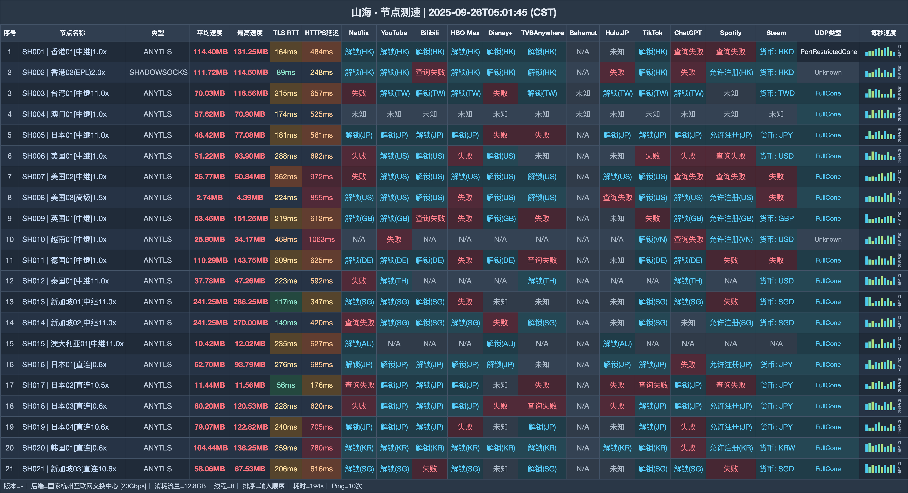

# 山海机场｜国内 15 元/月 128G，国际线路 5 元/月（2026-11-07 更新）

> **一句话评价：国内外分流之选：国内 15 元 128G，海外 5 元 256G**
>
> 👉 **[官网注册](https://shanhai.cfd/#/register?code=JCTl4PVQ)** · 国内用户从 15 元通用档开始；人在海外就选 5 元国际小杯。

**适合：**

- 国内用户想要 128G—2048G 清晰分档
- 设备多，希望不限设备、不限速
- 海外用户需要单独的国际入口

**不适合：**

- 海外用户购买通用档——商家明确建议不要买
- 电信晚高峰只想用国际小杯——该线路可能受影响

| | |
|---|---|
| 国内起步 | 15 元/月 128G |
| 国际起步 | 5 元/月 256G |
| 设备 | 不限 |
| 限速 | 不限 |
| 协议 |  AnyTLS / Shadowsocks |
| 套餐结构 | 5 档通用 + 1 档国际 |

**关于山海**：山海（shanhai）分通用档与国际档：通用 15 元/月 128G 走国内入口，国际小杯 5 元/月 256G，入口见本文注册链接。

## 套餐

| 套餐 | 价格 | 流量 | 设备 | 限速 | 说明 |
|---|---:|---:|---:|---:|---|
| 通用套餐-迷你 | ¥15/月付 | 128G · 每月 | 不限 | 不限 | 国内入口；海外客户请勿购买 |
| 通用套餐-入门 | ¥25/月付 | 256G · 每月 | 不限 | 不限 | 国内入口；海外客户请勿购买 |
| 通用套餐-基础 | ¥45/月付 | 512G · 每月 | 不限 | 不限 | 国内入口；海外客户请勿购买 |
| 通用套餐-进阶 | ¥85/月付 | 1024G · 每月 | 不限 | 不限 | 国内入口；海外客户请勿购买 |
| 通用套餐-高级 | ¥165/月付 | 2048G · 每月 | 不限 | 不限 | 国内入口；海外客户请勿购买 |
| 国际套餐-小杯 | ¥5/月付 | 256G · 每月 | 不限 | 不限 | Amazon 5Gbps全球骨干网；国际线路晚高峰电信可能不佳 |

> 通用档面向国内入口；国际小杯走 Amazon 5Gbps 全球骨干网，同时提示电信晚高峰可能不佳。流量只在重置日重置；重置包不增加时长，续购只增加时长。

## 测速参考

共 21 个节点（下载/延迟），测试端 国家杭州互联网交换中心 [20Gbps]，完整记录见下图与 `data/`。

## 怎么选

- 国内轻度用户可看 15 元 128G；用量更高再比较 25 元 256G。
- 需要 512G 可看 45 元基础档；不限设备，但不限设备不等于允许转售或公开分享。
- 海外用户可比较 5 元国际小杯，不要误买国内入口通用档。

## 注册

👉 **[官网注册](https://shanhai.cfd/#/register?code=JCTl4PVQ)** · 国内用户从 15 元通用档开始；人在海外就选 5 元国际小杯。

*本文使用推广链接，注册或购买后本站可能获得佣金。*

## 更新

- **2026-11-07** — 每日复核：套餐、价格与公告无变化；多账号发布对齐核查完成。
- **2026-11-06** — 每日复核：套餐、价格与公告无变化；多账号发布对齐核查完成。
- **2026-11-05** — 每日复核：套餐、价格与公告无变化；多账号发布对齐核查完成。
- **2026-11-04** — 每日复核：套餐、价格与公告无变化；多账号发布对齐核查完成。
- **2026-11-02** — 每日复核：套餐、价格与公告无变化；多账号发布对齐核查完成。
- **2026-10-31** — 整理当前套餐资料，共 6 个套餐/展示项；加入节点测速参考。
- **2025-09-25** — 节点测速记录日期。

---
*价格、节点和活动会变化，下单时以套餐页显示为准。*

---

相关搜索：山海 / shanhai / 机场推荐

本文关键词：山海、shanhai、山海机场、山海vpn、机场推荐、机场测评、机场推荐2026、科学上网、代理、VPN、clash 订阅、山海官网、山海注册、山海测速

